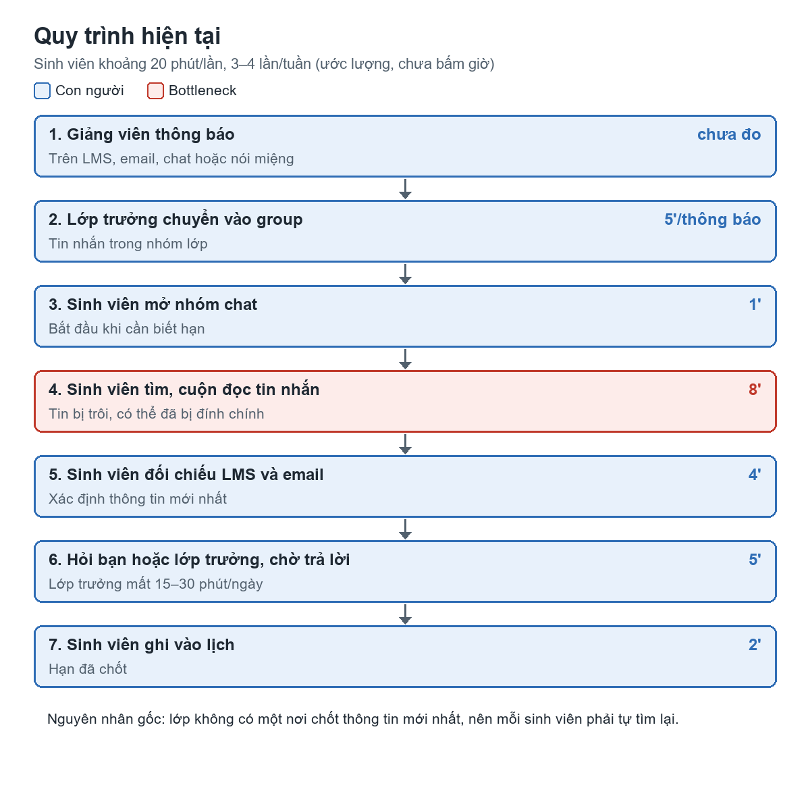
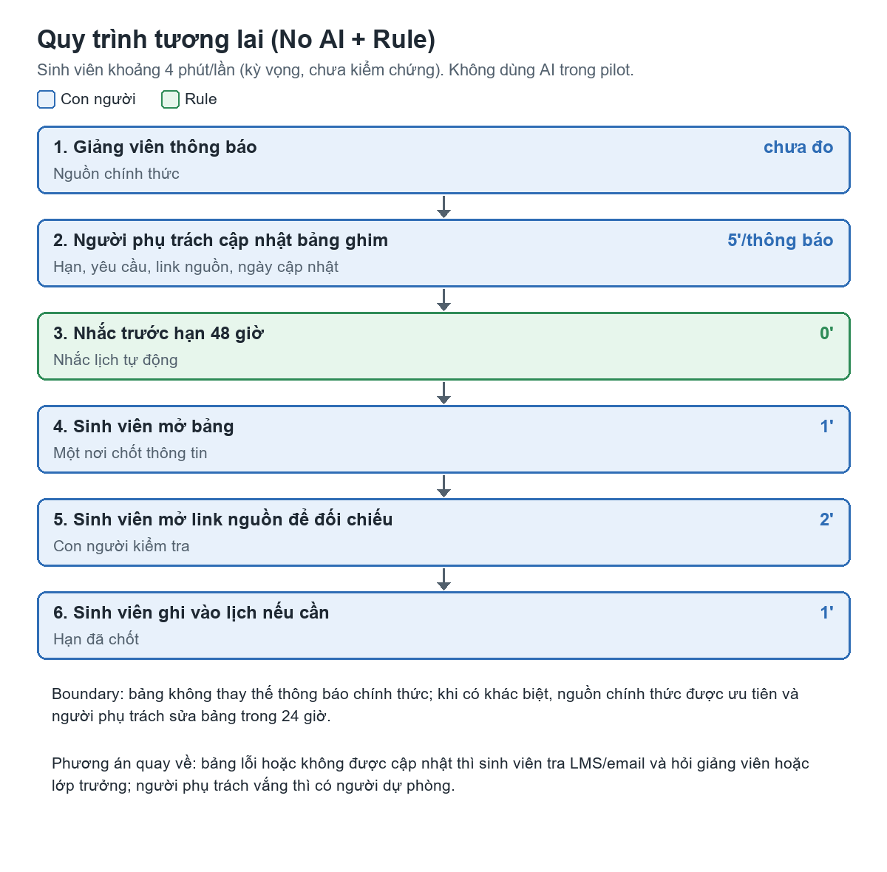

# Báo cáo nhóm — Day 02 Discovery & Problem Framing

> **Phạm vi bản này:** tổng hợp với hỗ trợ của AI từ CP1–CP2 trong 4 báo cáo cá nhân. Nhóm chưa phỏng vấn hoặc khảo sát. Mục ghi "chưa ghi nhận" hoặc "chưa thực hiện" nghĩa là repo chưa có dữ liệu thật. Điểm số, mức chọn và quyết định là đề xuất.

## 1. Thông tin nhóm

- Tên nhóm: Nhom4connguoi
- Thành viên: xem `TEAM.md`
- Candidate problem được chọn (1 câu): Khi sắp làm bài, sinh viên học nhiều môn muốn biết chắc hạn nộp và yêu cầu mới nhất của từng môn, để không phải lục lại nhiều kênh, không nộp trễ và không làm theo thông báo cũ.
- Quyết định cuối: **Not Yet** (đề xuất): chưa đưa AI vào; kiểm chứng và chạy thử phương án No AI + Rule trước.

---

## 2. Hội tụ nhóm (CP3)

### 2.1. Pitch

Nguồn: top 3 trong báo cáo cá nhân. Các con số đều là ước lượng của người đưa ra, chưa bấm giờ thật. Cột phản biện hiện chỉ có phản biện của AI ở CP2 đã ghi trong báo cáo cá nhân; câu hỏi của thành viên khi pitch chưa được ghi lại.

| # | Người đưa ra | Candidate (Job Story ngắn) | Actor | Bottleneck | Câu hỏi phản biện nhận được (ai hỏi) |
|---:|---|---|---|---|---|
| 1 | Đinh Hoàng Phong | Khi nộp đơn trên FAP, tôi muốn biết đơn đúng loại và đúng yêu cầu trước khi gửi, để không bị trả lại | Sinh viên ĐH FPT nộp đơn trên FAP | Chờ duyệt 2–3 ngày/lần mới biết đơn sai; bị trả 2 lần, tổng khoảng 6–9 ngày | AI (CP2): hai lý do bị trả là hai nguyên nhân khác nhau, lý do nào hay xảy ra hơn? · Thành viên hỏi: chưa ghi nhận |
| 2 | Đinh Hoàng Phong | Khi viết chức năng cho sản phẩm khách hàng, tôi muốn biết trước nó có làm hệ thống chậm không, để không phải sửa lại | Lập trình viên, tester, team lead | Chậm 20% chỉ lộ ra sau khi qua tester; khoảng 3 giờ/lần, 2 lần tuần vừa rồi | Chưa ghi nhận |
| 3 | Đinh Hoàng Phong | Khi chuẩn bị vào chương trình AI của VinUni, tôi muốn tìm nhanh luật lệ, quy trình, để không phải lục nhiều nguồn | Người chuẩn bị tham gia chương trình | Tài liệu khó hiểu, phải hỏi lại người đã biết; khoảng 4 giờ/tuần chuẩn bị | Chưa ghi nhận |
| 4 | Đỗ Hồng Vỹ | Khi tối ngồi làm bài, tôi muốn biết chắc hạn nộp và yêu cầu mới nhất, để không nộp trễ hoặc làm theo thông báo cũ | Sinh viên học nhiều môn, nhận tin từ chat, LMS, email | Tìm, cuộn đọc tin nhắn: khoảng 8 phút trong tổng 20 phút/lần | Câu Vỹ chuẩn bị: "Nếu lớp có bảng deadline chung thì vì sao bảng đó có thể không được cập nhật?" · AI (CP2): nghẽn thật có thể là lớp không có nơi chốt thông báo, không phải bước tìm · Thành viên hỏi: chưa ghi nhận |
| 5 | Đỗ Hồng Vỹ | Khi cuối tháng nhận hóa đơn, tôi muốn biết mỗi người trả bao nhiêu, để cả phòng chuyển khoản nhanh | Người giữ việc thu tiền, phòng 3–4 người | Tìm lại khoản đã ứng: khoảng 25 phút trong 65 phút/tháng | AI (CP2): đã có Sheets và Splitwise thì vì sao vẫn còn vấn đề? · Thành viên hỏi: chưa ghi nhận |
| 6 | Đỗ Hồng Vỹ | Khi nhận tin đáng ngờ, bố mẹ tôi muốn biết thật hay lừa trước khi bấm link, chuyển tiền, để không mất tiền | Phụ huynh ít quen công nghệ; người con được nhờ | Chờ con trả lời: khoảng 30 phút/lần | AI (CP2): actor là bố mẹ hay người con? Nói nhầm "an toàn" có thể gây mất tiền · Thành viên hỏi: chưa ghi nhận |
| 7 | Nguyễn Việt Hoàng | Khi đến nơi chưa quen, tôi muốn chọn tuyến và biết thời gian di chuyển, để không đến muộn | Sinh viên cần di chuyển đúng giờ | Chưa xác định: cân nhắc tuyến hoặc ước lượng giờ đến, cần bấm giờ | Chưa ghi nhận |
| 8 | Nguyễn Việt Hoàng | Khi hộp thư có nhiều email, tôi muốn nhận ra email cần phản hồi và có hạn chót, để không bỏ sót | Sinh viên nhận email từ giảng viên, trường, nhóm | Đọc và phân loại email; chưa đo thời gian | Chưa ghi nhận |
| 9 | Nguyễn Việt Hoàng | Khi cuối tuần, tôi muốn biết các khoản chi nhỏ cộng lại bao nhiêu, để điều chỉnh trước khi vượt ngân sách | Người tự quản lý chi tiêu cá nhân | Ghi lại khoản nhỏ ngay sau khi chi; chưa đo thời gian | Chưa ghi nhận |
| 10 | Nguyễn Ánh Dương | Khi tìm phòng trọ trước nhập học, tôi muốn so sánh giá, khoảng cách, độ tin cậy từ nhiều bài đăng, để không bị hớ hay lừa cọc | Sinh viên năm nhất từ tỉnh lên, ngân sách 1,5–3 triệu/tháng | Đọc, chép bài đăng không theo mẫu: 5–8 phút/bài, khoảng 3–5 giờ | Câu Dương chuẩn bị: "Trang cho thuê đã có bộ lọc, sao vẫn tìm qua nhóm: vấn đề là đọc thông tin hay niềm tin vào bài đăng?" · AI (CP2): bottleneck thật có thể là xác minh độ tin cậy · Thành viên hỏi: chưa ghi nhận |
| 11 | Nguyễn Ánh Dương | Khi gần deadline, tôi muốn biết hạn chót, nơi nộp, yêu cầu từng môn, để không phải lục tin nhắn hay hỏi lại lớp trưởng | Sinh viên 5–7 môn/kỳ; lớp trưởng | Lục lại tin: 5–10 phút/lần; lớp trưởng trả lời 15–30 phút/ngày | Chưa ghi nhận |
| 12 | Nguyễn Ánh Dương | Khi ôn thi cuối kỳ, tôi muốn gom và lọc trọng tâm từ nhiều tài liệu, để dành thời gian học | Sinh viên có 5–7 môn thi trong 2–3 tuần | Tìm đề cũ, đọc lướt, đối chiếu: 180–300 phút/môn | Chưa ghi nhận |

### 2.2. Cluster

| Cluster | Các candidate | Pattern chung |
|---|---|---|
| A — Tìm lại thông tin học vụ, công việc | #3, #4, #8, #11 | Thông tin nằm ở nhiều kênh, phải tìm và xác định đâu là bản đúng, mới nhất. #4 và #11 thực chất là cùng một problem do hai người độc lập đưa ra |
| B — Gom, so sánh nhiều nguồn trước khi quyết định | #10, #12 | Đọc nhiều nội dung không theo mẫu rồi tự tổng hợp |
| C — Theo dõi tiền | #5, #9 | Khoản phát sinh không được ghi ngay nên cuối kỳ phải nhớ lại |
| D — Phát hiện lỗi quá muộn | #1, #2 | Chỉ biết sai sau khi qua bước kiểm của người khác, phải làm lại |
| E — Cần đánh giá nhanh một tình huống | #6, #7 | Phải quyết định ngay khi thiếu thông tin hoặc thiếu người hỗ trợ |

### 2.3. Opportunity Solution Tree rút gọn

Gốc là **1 outcome**. Nhánh là **opportunity** (nhu cầu, pain), không phải tính năng hay công cụ.

```text
OUTCOME: Giảm thời gian sinh viên dùng để xác định hạn nộp và yêu cầu mới nhất,
         đồng thời không còn lần nộp trễ hoặc làm theo thông báo cũ
├── Opportunity A: Thông báo rải ở chat, LMS, email, không có nơi chốt thông tin
├── Opportunity B: Đính chính đến sau, khó biết thông tin nào còn hiệu lực
├── Opportunity C: Lớp trưởng phải trả lời lặp lại cùng một câu hỏi
└── Opportunity D: Email có hạn chót bị lẫn trong nhiều email không quan trọng
```

Những ý đã gạch bỏ vì là solution đội lốt opportunity:

- ✗ "Bảng deadline chung được ghim": solution cho A và B, chuyển xuống mục 6.
- ✗ "AI trích hạn nộp từ tin nhắn": solution, chỉ xét khi No AI và Rule không đủ.
- ✗ "Lọc, gắn nhãn email": solution cho D.

### 2.4. Chấm điểm shortlist (1–5)

| Candidate | Actor rõ | Quy trình rõ | Pain có bằng chứng | Impact đo được | Vừa sức lab | So sánh được No AI/Rule/Workflow/Agent | Nhóm hiểu domain | Tổng |
|---|---:|---:|---:|---:|---:|---:|---:|---:|
| Tìm hạn nộp, yêu cầu mới nhất (#4 + #11) | 5 | 5 | 3 | 4 | 5 | 5 | 5 | **32** |
| Tìm phòng trọ qua nhóm (#10) | 4 | 5 | 3 | 3 | 3 | 4 | 4 | 26 |
| Đơn FAP bị trả lại (#1) | 4 | 4 | 3 | 2 | 4 | 4 | 2 | 23 |

Điểm trên là đề xuất dựa trên báo cáo cá nhân, chưa có biên bản chấm điểm của nhóm.

**Candidate được chọn:** Tìm hạn nộp và yêu cầu mới nhất của môn học.

**Vì sao chọn:** Hai thành viên độc lập đưa ra cùng problem, thành viên thứ ba có problem gần với nó (#8). Cả nhóm hiểu domain và có thể tiếp cận bạn học ở nhóm khác để phỏng vấn. Quy trình vẽ được, đo được bằng bấm giờ. Bài này cũng buộc nhóm trả lời câu hỏi thật sự: bảng deadline chung đã đủ chưa.

**Vì sao loại các candidate còn lại:**

- **Phòng trọ:** Chỉ nặng theo mùa (tháng 7–9) nên khó đo trong thời gian lab. Việc lấy dữ liệu bài đăng chưa rõ có hợp lệ không. Bottleneck thật có thể là độ tin cậy của bài đăng, không phải việc đọc.
- **Đơn FAP:** Impact thấp theo chính ghi nhận của Phong (viết lại khoảng 10 phút và chờ thêm). Thời gian chờ do phía trường quyết định, và chỉ người học tại FPT hiểu rõ domain.
- **Các candidate khác:** Chức năng chậm (#2) khó trình bày đầy đủ vì liên quan thông tin nội bộ khách hàng. Chia tiền phòng (#5) có đúng/sai rõ, Sheets hoặc Splitwise có thể đã đủ.

**Xử lý bất đồng (nếu có):** Chưa ghi nhận.

---

## 3. Kiểm chứng + research giải pháp đã có (CP4)

### 3.1. Assumption Map

| # | Giả định | Loại (Value / Usability / Feasibility / Viability) | Quan trọng (1–5) | Đã có bằng chứng (1–5) | Kiểm chứng trước? |
|---:|---|---|---:|---:|---|
| 1 | Sinh viên ngoài nhóm cũng mất trên 10 phút/lần, ít nhất 2 lần/tuần để tìm hạn nộp | Value | 5 | 2 | ✅ |
| 2 | Đã có lần nộp trễ, làm sai vì thông báo trôi hoặc bị đính chính | Value | 5 | 1 | ✅ |
| 3 | Thông tin hạn nộp thường nằm ngoài LMS, nên LMS không tự giải được | Value | 5 | 2 | ✅ |
| 4 | Một người phụ trách có thể duy trì bảng chung ít nhất 4 tuần | Viability | 5 | 1 | ✅ Qua pilot |
| 5 | Sinh viên sẽ mở bảng thay vì hỏi lại trong group | Usability | 4 | 1 | ✅ Qua pilot |
| 6 | Có thể lấy tin nhắn nhóm chat một cách hợp lệ nếu sau này cần AI đọc | Feasibility | 3 | 1 | Chỉ khi cần xét Workflow |

Giả định cần kiểm chứng trước: #1, #2, #3 (chưa thực hiện).

### 3.2. Kiểm chứng

Cách đã dùng: Chưa thực hiện phỏng vấn, survey hoặc phân tích log.

Câu hỏi cho đợt kiểm chứng tiếp theo (theo The Mom Test; hỏi bạn học ngoài nhóm, không hỏi thành viên nhóm mình):

1. Lần gần nhất bạn phải đi tìm lại hạn nộp hoặc yêu cầu bài là khi nào? Kể lại từng bước.
2. Lần đó mất khoảng bao lâu? Bước nào lâu nhất? Tuần trước bạn gặp mấy lần?
3. Thông tin cuối cùng bạn lấy từ đâu: LMS, email, chat hay hỏi bạn?
4. Học kỳ này bạn có lần nào nộp trễ hoặc làm theo thông báo cũ không? Chuyện gì đã xảy ra?
5. Lớp bạn đã thử cách nào, như file deadline chung? Hiện còn dùng không, ai cập nhật?

Interview snapshot: chưa có, vì chưa thực hiện phỏng vấn.

Tổng hợp:

| Nguồn | Số người / số mẫu | Tín hiệu xác nhận | Tín hiệu phản bác |
|---|---:|---|---|
| Phỏng vấn / survey | 0 | Chưa thực hiện | Chưa thực hiện |
| Tự ghi nhận của thành viên (chỉ là giả thuyết đầu vào, **không tính là kiểm chứng**) | 3 | Vỹ ước lượng 20 phút/lần, 3–4 lần/tuần; Dương ước lượng 5–10 phút/lần và khoảng 10 câu hỏi lặp lại/tuần; Hoàng nhận hàng chục email/ngày | Vỹ và Dương đều ghi "có thể chỉ cần file hoặc bảng deadline chung"; Dương ghi LMS có thể đã có sẵn; chưa ai nêu một lần nộp trễ cụ thể |

**Nhóm đã sửa problem thế nào sau kiểm chứng:**

- Sau research (mục 3.3): chuyển trọng tâm từ "tìm trong tin nhắn chậm" sang "lớp thiếu một nơi chốt thông tin mới nhất". LMS chỉ giúp được với bài có đặt hạn trong hệ thống, còn đính chính trên chat thì không.
- Sau phỏng vấn/survey: chưa có thay đổi vì chưa kiểm chứng; problem chưa được xác nhận từ người dùng ngoài nhóm.

### 3.3. Research giải pháp đã có

| Công cụ / case / pattern | Link | Giải bước nào trong quy trình? | Điểm mạnh | Khoảng trống / rủi ro | Bài học cho nhóm |
|---|---|---|---|---|---|
| Lịch của Google Classroom và Google Calendar | https://support.google.com/edu/classroom/answer/6272985 | Bước tra hạn, nếu giảng viên giao bài trên hệ thống | Xem hạn của mọi lớp ở một nơi; có thể thêm nhắc nhở cá nhân trên Google Calendar | Chỉ hiện mục có đặt hạn; không có thông báo từ chat hay đính chính miệng | Kiểm tra LMS thật của lớp trước. Nếu giảng viên đặt hạn đầy đủ thì problem có thể không còn |
| Nhắc hẹn nhóm Zalo (bài hướng dẫn năm 2021, cần kiểm lại trên app hiện tại) | https://quantrimang.com/cong-nghe/cach-tao-lich-hen-tren-nhom-chat-zalo-pc-156529 | Bước nhắc trước hạn | Có sẵn trong nhóm chat; mọi thành viên nhận thông báo; mặc định ghim đầu nhóm | Vẫn phải có người tạo; chỉ người tạo được sửa hoặc xóa | Dùng được làm Rule mà không cần công cụ mới; rủi ro "phụ thuộc một người" vẫn còn |
| Nút "Add to calendar" của Gemini trong Gmail | https://workspaceupdates.googleblog.com/2025/03/add-events-to-google-calendar-using-gemini-in-gmail.html | Bước trích hạn từ email | AI nhận ra nội dung liên quan lịch ngay trong email | Theo bài đăng 03/2025: chỉ tiếng Anh, trên web, thuộc một số gói nhất định; không đọc được nhóm chat | Việc trích hạn bằng AI đã có sản phẩm, không nên tự xây; chưa chắc dùng được với thông báo tiếng Việt |
| Template Zapier: Gmail + AI + Google Calendar | https://zapier.com/templates/details/34f7f11d27aa22bcd0b5e4207c4537d2d59e0c4451dd56dfc3a4199c482ba2d8 | Trích hạn rồi tạo nhắc lịch | Đúng dạng Workflow: các bước định sẵn, AI làm một bước | Mẫu dành cho hóa đơn; trang không nêu bước người duyệt | Nếu sau này cần AI thì mượn kiến trúc này và thêm bước người kiểm tra |

**Kết luận research:** Các công cụ đều xử lý tốt phần hạn đã có cấu trúc hoặc nằm trong email, nhưng chưa thấy công cụ nào trong số này giải quyết việc chốt đính chính từ nhóm chat. Không có lý do tự xây; nên thử quy trình và công cụ có sẵn trước.

---

## 4. Quy trình trước/sau (CP5)

### 4.1. Quy trình hiện tại

Sơ đồ (thời gian là ước lượng từ báo cáo của Vỹ và Dương, chưa bấm giờ):

```text
HIỆN TẠI — sinh viên khoảng 20 phút/lần, 3–4 lần/tuần

[1 GV thông báo] → [2 Lớp trưởng chuyển vào group: 5']
→ [3 SV mở nhóm chat: 1'] → [4 SV tìm, cuộn đọc tin nhắn: 8'] ← BOTTLENECK
→ [5 SV đối chiếu LMS + email: 4'] → [6 Hỏi bạn/lớp trưởng, chờ trả lời: 5']
→ [7 SV ghi vào lịch: 2']
```



| Bước | Actor | Input | Output | Thời gian / tần suất | Ghi chú |
|---:|---|---|---|---|---|
| 1 | Giảng viên | Yêu cầu bài, hạn nộp | Thông báo trên LMS, email, chat hoặc nói miệng | Chưa đo | Có thể đính chính sau |
| 2 | Lớp trưởng | Thông báo của giảng viên | Tin nhắn trong group | Khoảng 5 phút/thông báo | Chuyển giao từ giảng viên sang lớp |
| 3 | Sinh viên | Nhu cầu biết hạn | Nhóm chat của môn | Khoảng 1 phút/lần | 3–4 lần/tuần |
| 4 | Sinh viên | Lịch sử chat | Tin nhắn nghi là đúng | Khoảng 8 phút/lần | Tin bị trôi, có thể đã bị đính chính |
| 5 | Sinh viên | Tin tìm được, LMS, email | Thông tin đã đối chiếu | Khoảng 4 phút/lần | |
| 6 | Sinh viên, bạn, lớp trưởng | Câu hỏi còn chưa chắc | Câu trả lời | Khoảng 5 phút/lần; lớp trưởng 15–30 phút/ngày | Chuyển việc sang lớp trưởng |
| 7 | Sinh viên | Hạn đã chốt | Mục trong lịch cá nhân | Khoảng 2 phút/lần | |

**Bottleneck chính:** Bước 4, tìm và cuộn đọc tin nhắn, khoảng 8 phút/lần. Nguyên nhân gốc nằm ở bước 2: lớp không có một nơi chốt thông tin mới nhất, nên mọi sinh viên phải tìm lại riêng lẻ.

### 4.2. Quy trình tương lai

Bản pilot không dùng AI.

```text
TƯƠNG LAI — sinh viên khoảng 4 phút/lần (kỳ vọng, chưa kiểm chứng)

[1 GV thông báo]
→ [2 Người phụ trách cập nhật bảng ghim: hạn, yêu cầu, link nguồn, ngày cập nhật: 5'] ← CON NGƯỜI
→ [3 Nhắc trước hạn 48 giờ: 0'] ← RULE (nhắc lịch)
→ [4 SV mở bảng: 1'] → [5 SV mở link nguồn để đối chiếu: 2'] ← CON NGƯỜI
→ [6 SV ghi vào lịch nếu cần: 1'] ← CON NGƯỜI

AI: không dùng ở bước nào trong pilot này.
BOUNDARY: bảng không thay thế thông báo chính thức. Khi bảng và LMS/email của GV
          khác nhau, nguồn chính thức được ưu tiên. Người phụ trách sửa bảng trong 24 giờ.
          Nếu sau này thêm AI: AI chỉ đề xuất kèm tin gốc, không tự đăng hay sửa hạn;
          người phụ trách duyệt trước khi lên bảng.
PHƯƠNG ÁN QUAY VỀ: bảng lỗi hoặc không được cập nhật → SV tra LMS/email và hỏi GV hoặc
                   lớp trưởng như hiện tại; người phụ trách vắng → có một người dự phòng.
```



### 4.3. Before / after

| Chỉ số | Trước | Sau (kỳ vọng) | Ghi chú |
|---|---:|---:|---|
| Số bước | 7 | 6 | Sinh viên còn 3 bước thay vì 5 |
| Tổng thời gian | Khoảng 20 phút/lần | Khoảng 4 phút/lần | Thời gian của sinh viên; ước lượng, cần bấm giờ |
| Số bước thủ công | 7/7 | 5/6 | Bước nhắc do Rule xử lý |
| Bottleneck chính | Tìm, cuộn đọc tin nhắn | Người phụ trách cập nhật bảng | Thời gian dồn về một người: khoảng 5 phút/thông báo; đổi lại kỳ vọng giảm 15–30 phút/ngày trả lời |
| Rủi ro mới phát sinh | — | Bảng cũ khiến sinh viên tin nhầm; phụ thuộc một người | Xử lý bằng link nguồn, ngày cập nhật và người dự phòng |

---

## 5. Problem Statement v0 (CP5)

| Trường | Nội dung |
|---|---|
| **Actor** | Sinh viên học nhiều môn cùng lúc, nhận thông báo từ nhóm chat, LMS và email |
| **Quy trình** | Mở nhóm chat → tìm, cuộn đọc tin nhắn → đối chiếu LMS và email → hỏi bạn nếu chưa chắc → ghi vào lịch |
| **Bottleneck** | Tìm và cuộn đọc tin nhắn khoảng 8 phút/lần vì thông báo bị trôi và có thể đã bị đính chính |
| **Impact** | Khoảng 60–80 phút/tuần cho mỗi sinh viên (ước lượng); nguy cơ nộp trễ hoặc làm sai yêu cầu |
| **Success Metric** (baseline → target, cách đo) | Thời gian tìm: khoảng 20 phút/lần (ước lượng) → dưới 5 phút/lần; đo bằng sinh viên tự bấm giờ trong 2 tuần |
| **Boundary** (AI không được làm gì; khi nào cần con người kiểm tra — HITL) | Giải pháp, có AI hay không, không được tự đăng hoặc tự sửa hạn nộp. Con người kiểm tra với nguồn chính thức mỗi khi có đính chính hoặc thông tin không khớp |

Phản biện nhận được (từ AI hoặc nhóm khác) và nhóm có đồng ý không:

- AI phản biện card của Vỹ: nghẽn thật có thể là lớp không có nơi chốt thông báo, không phải bước tìm. Vỹ đã đồng ý trong báo cáo cá nhân; nội dung này được đưa vào v1.
- AI phản biện: số phút chỉ là ước lượng, chưa đo thật. Đồng ý; v1 giữ yêu cầu bấm giờ để lấy baseline thật.
- Phản biện từ nhóm khác: chưa ghi nhận.

---

## 6. Mức can thiệp AI (CP6)

### 6.1. Ma trận độ mơ hồ × độ phức tạp

Bài của nhóm nằm ở ô: **Độ mơ hồ thấp × độ phức tạp thấp**, nên Rule hoặc Workflow đơn giản thường đủ.

Vì sao: Hạn nộp có đúng/sai rõ, kiểm tra được với nguồn chính thức. Có 3 nguồn nhưng các bước cố định và không cần rẽ nhánh phức tạp. Phần mơ hồ duy nhất là đọc tin nhắn tự do, và phần này chỉ phát sinh nếu muốn tự động hóa bước nhập bảng.

### 6.2. So sánh 4 mức

| Mức | Phương án cho bài của nhóm | Đủ khi nào | Rủi ro | Chọn? |
|---|---|---|---|---|
| **No AI** (sửa quy trình) | Bảng deadline ghim, có người phụ trách và người dự phòng, ghi link nguồn và ngày cập nhật | Có người duy trì đều và sinh viên chịu mở bảng | Bảng cũ; phụ thuộc người phụ trách | **Chọn** |
| **Rule** | Nhắc trước hạn 48 giờ bằng nhắc hẹn hoặc lịch | Hạn đã được nhập vào bảng hoặc lịch | Nhắc theo hạn sai nếu bảng sai | **Chọn cho bước nhắc** |
| **Workflow** | AI đề xuất hạn từ thông báo kèm tin gốc → người phụ trách duyệt → cập nhật bảng | Pilot chứng minh việc nhập tay là điểm khiến bảng không được duy trì | Trích sai hạn; chưa rõ cách lấy tin nhắn nhóm hợp lệ | Chưa chọn; xét lại theo mục 8.2 |
| **Agent** | AI tự theo dõi các kênh, tự cập nhật, tự trả lời sinh viên | Các bước không đoán trước được; bài này không thuộc trường hợp đó | Tự đăng hạn sai; cần nhiều quyền truy cập | Không chọn |

**Mức chọn:** No AI + Rule.

**Vì sao không chọn mức đơn giản hơn:** No AI là mức đơn giản nhất và được giữ làm nền. Rule chỉ được thêm vì giúp nhắc trước hạn mà không tốn thêm việc thủ công và có thể dùng tính năng có sẵn.

**Vì sao chưa cần mức cao hơn:** Chưa có bằng chứng nào cho thấy bảng chung không đủ; cả Vỹ và Dương đều ghi nhận khả năng nó đã đủ. Workflow chỉ đáng xét khi pilot cho thấy đúng bước nhập tay là điểm hỏng.

### 6.3. AI Canvas rút gọn

Không áp dụng vì mức chọn là No AI + Rule. Bài toán không cần AI tạo nội dung: hạn nộp có đúng/sai rõ và đã có sẵn trong thông báo gốc, nên con người sao chép vào bảng là đủ. Rule xử lý được bước nhắc. Chưa có kiểm chứng nào cho thấy người dùng cần giao việc này cho AI.

### 6.4. Hai câu hỏi của Google PAIR

Không áp dụng vì mức chọn là No AI + Rule. Nếu pilot dẫn đến xét Workflow, nhóm sẽ trả lời hai câu này từ kết quả kiểm chứng. Giả thuyết ban đầu: sai hạn hoặc bỏ sót đính chính tệ hơn báo nhầm, vì có thể dẫn đến nộp trễ, nên luôn cần tin gốc và người duyệt.

---

## 7. Problem Statement v1 + tiêu chí đánh giá (CP6)

| Trường | Nội dung |
|---|---|
| **Actor** | Chính: sinh viên học nhiều môn (Dương ghi 5–7 môn/kỳ) ở lớp nhận thông báo qua nhiều kênh ngoài LMS. Phụ: lớp trưởng phải trả lời câu hỏi lặp lại |
| **Quy trình** | Giảng viên thông báo → lớp trưởng chuyển vào group → sinh viên tìm lại trong chat → đối chiếu LMS và email → hỏi lại → ghi vào lịch |
| **Bottleneck** | Lớp không có nơi chốt thông tin mới nhất, nên mỗi sinh viên phải tự tìm và cuộn đọc tin nhắn (khoảng 8 phút/lần, ước lượng) |
| **Impact** | Khoảng 60–80 phút/tuần cho mỗi sinh viên; lớp trưởng 15–30 phút/ngày (ước lượng); nguy cơ nộp trễ, làm theo thông báo cũ |
| **Success Metric** (baseline → target, cách đo) | (1) Thời gian tìm: bấm giờ 1 tuần trước pilot (ước lượng khoảng 20 phút/lần) → dưới 5 phút/lần, tự bấm giờ trong 2 tuần pilot. (2) Lần nộp trễ hoặc làm theo thông báo cũ: đếm 4 tuần trước → 0 trong 4 tuần sau. (3) Câu hỏi lặp lại trong group: đếm 1 tuần trước (ước lượng khoảng 10/tuần) → dưới 2/tuần |
| **Boundary** | Bảng không thay thế thông báo chính thức; nguồn chính thức được ưu tiên khi có khác biệt. Không có AI trong pilot. Nếu sau này thêm AI: AI không tự đăng, không tự sửa hạn; người phụ trách duyệt mọi thay đổi |
| **AI intervention point** | Không có. Lý do: hạn nộp có đúng/sai rõ, và chưa có bằng chứng No AI + Rule không đủ |
| **Mức chọn** | No AI + Rule |
| **Rủi ro & người kiểm tra** | Bảng cũ hoặc sai làm sinh viên tin nhầm; người phụ trách nghỉ giữa chừng. Người phụ trách cập nhật và ghi ngày, sinh viên đối chiếu link nguồn, người dự phòng thay khi cần |

**Thay đổi so với v0 và lý do:**

| Trường | v0 | v1 | Vì sao đổi |
|---|---|---|---|
| Actor | Sinh viên học nhiều môn | Thêm lớp trưởng; giới hạn ở lớp có thông báo ngoài LMS | Card của Dương nêu tải của lớp trưởng; research cho thấy lịch LMS chỉ hiện mục có đặt hạn |
| Bottleneck | Tìm, cuộn đọc tin nhắn | Thiếu nơi chốt thông tin mới nhất | Phản biện của AI trong card của Vỹ: tìm chậm là hệ quả, không phải gốc |
| Success Metric | Chỉ đo thời gian | Thêm số lần nộp trễ và số câu hỏi lặp lại | Đọc nhanh hơn mà vẫn sai hạn thì không đạt |
| Boundary | Giải pháp không tự đăng, tự sửa | Thêm ưu tiên nguồn chính thức, không có AI trong pilot | Mức chọn đã chốt là No AI + Rule |

**Tiêu chí đánh giá giải pháp không dùng AI:**

| # | Tiêu chí | Đạt khi | Không đạt khi |
|---:|---|---|---|
| 1 | Đúng thông tin | Hạn và yêu cầu trên bảng khớp nguồn chính thức ở mọi mục được kiểm | Có mục sai hạn hoặc sai yêu cầu |
| 2 | Có nguồn | Mọi mục có link nguồn (hoặc ghi "GV thông báo tại lớp") và ngày cập nhật | Có mục không truy được nguồn |
| 3 | Kịp đính chính | Đính chính lên bảng trong vòng 24 giờ | Quá 24 giờ hoặc không được cập nhật |
| 4 | Đủ phạm vi | Mọi bài có hạn của các môn trong pilot đều có trên bảng | Sinh viên phải quay lại chat vì bảng thiếu bài |
| 5 | Tìm nhanh | Sinh viên có câu trả lời trong dưới 5 phút | Mất từ 5 phút trở lên hoặc vẫn phải hỏi lại group |

---

## 8. Quyết định (CP6)

### 8.1. Bốn rủi ro

| Rủi ro | Câu hỏi | Mức độ rủi ro (Thấp = an toàn / TB / Cao = nguy hiểm) | Lý do / bằng chứng |
|---|---|---|---|
| **Value** | Người dùng có thật sự cần và sẽ dùng không? | **Cao** | Hiện chỉ có ước lượng của thành viên nhóm, chưa có kiểm chứng từ người ngoài nhóm và chưa có lần nộp trễ cụ thể |
| **Usability** | Người dùng có dùng được, có hiểu và sửa được đầu ra của AI không? | TB | Bảng dễ dùng, không có đầu ra AI; nhưng chưa biết sinh viên có đổi thói quen hỏi trong group không |
| **Feasibility** | Có đủ dữ liệu, công cụ, kỹ năng để làm không? | Thấp | Chỉ cần bảng tính và nhắc lịch có sẵn; không cần tích hợp dữ liệu |
| **Viability** | Có hợp chi phí, pháp lý, quy định tổ chức không? Ai vận hành? | TB | Không tốn chi phí công cụ, không đọc tin nhắn bằng AI; nhưng chưa có ai cam kết duy trì bảng |

### 8.2. Kết luận

**Quyết định:** **Not Yet** (đề xuất).

**Lý do:** Value đang ở mức Cao nhưng kiểm chứng được nhanh. Chưa có bằng chứng cần AI, trong khi No AI + Rule chi phí thấp và thử được ngay.

**Nếu Go — pilot nhỏ nhất:** Chưa áp dụng.

**Nếu Not Yet — cần kiểm chứng gì trước:**

1. Phỏng vấn 3 bạn học ngoài nhóm hoặc khảo sát 5–10 người về lần tìm hạn gần nhất (giả định #1, #2, #3).
2. Mở LMS thật của lớp và đếm trong 1 môn: bao nhiêu hạn có trên LMS, bao nhiêu chỉ có trên chat hoặc email.
3. Bấm giờ 1 tuần để có baseline thật, đếm câu hỏi lặp lại trong group.
4. Chạy thử bảng chung và nhắc lịch trên 2 môn trong 2 tuần, có 1 người phụ trách và 1 người dự phòng (giả định #4, #5).

**Nếu No-Go — nên làm gì thay AI:** Chưa áp dụng ở thời điểm này. Nếu pilot đạt ngưỡng dưới đây thì kết luận No-Go với AI và giữ bảng chung + nhắc lịch.

**Ngưỡng dừng** (nếu sau … mà … thì quay về …):

- Nếu sau kiểm chứng, dưới một nửa số người được hỏi có lần tìm hạn mất trên 10 phút trong 2 tuần gần nhất → dừng bài này, quay về shortlist (phòng trọ).
- Nếu sau 2 tuần pilot, thời gian tìm dưới 5 phút/lần và không có lần nộp trễ do thông tin sai → No-Go với AI, giữ No AI + Rule.
- Nếu sau 2 tuần pilot, bảng trễ đính chính quá 24 giờ từ 2 lần trở lên vì người phụ trách không kịp nhập → xét Workflow có người duyệt.
- Nếu sau 2 tuần pilot, sinh viên vẫn hỏi lại trong group trên 5 câu/tuần dù bảng đúng và đủ → vấn đề nằm ở thói quen, dừng thêm công cụ và xem lại cách truyền thông.

---

## 9. Hạn chế và hướng tiếp theo

- Chưa có phỏng vấn hoặc survey với người ngoài nhóm, nên Value vẫn là rủi ro Cao.
- Mọi baseline hiện là ước lượng của thành viên nhóm, chưa bấm giờ thật. Hai người cũng ước lượng ở mức khác nhau: 8 phút (Vỹ) và 5–10 phút (Dương) cho bước lục tin, 20 phút cho toàn bộ quy trình (Vỹ).
- Bài chưa kiểm tra LMS thật của lớp. Nếu giảng viên đặt hạn đầy đủ trên LMS, problem có thể thu hẹp đáng kể.
- Bài đăng về Gemini và về Zalo có từ 2025 và 2021, nên tính năng hiện tại có thể đã khác; cần kiểm lại khi dùng.
- Hướng tiếp theo: "Email có hạn chót bị lẫn" (#8) và "Tìm phòng trọ" (#10) là các candidate cho vòng sau.

## 10. Tài liệu tham khảo

- Báo cáo cá nhân của các thành viên trong [report/individual/](../individual/).
- Hướng dẫn và framework của lab: [docs/01-worksheet.md](../../docs/01-worksheet.md).
- Google Classroom Help, *View due dates and events in a calendar*: https://support.google.com/edu/classroom/answer/6272985
- Quản Trị Mạng, *Cách tạo nhắc hẹn, kỷ niệm nhóm trên Zalo* (2021): https://quantrimang.com/cong-nghe/cach-tao-lich-hen-tren-nhom-chat-zalo-pc-156529
- Google Workspace Updates, *Quickly add events to Google Calendar based on your emails with Gemini in Gmail* (03/2025): https://workspaceupdates.googleblog.com/2025/03/add-events-to-google-calendar-using-gemini-in-gmail.html
- Zapier, *Extract due dates from Gmail, analyze with AI, run code, and create Google Calendar reminders*: https://zapier.com/templates/details/34f7f11d27aa22bcd0b5e4207c4537d2d59e0c4451dd56dfc3a4199c482ba2d8
